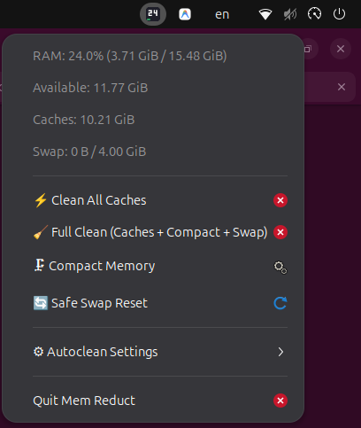

# Mem Reduct (Linux Edition)

<p align="center">
  <b>English</b> | <a href="README.ru.md">🇷🇺 Читать на русском</a>
</p>

<p align="center">
  <a href="https://github.com/anntr1k3/memreduct-linux/releases"></a>
  
  
</p>

A high-performance, lightweight system memory monitor and cleaner for Linux, written in **100% Rust** inspired by [henrypp/memreduct](https://github.com/henrypp/memreduct).

<p align="center">
  
</p>

Designed specifically for modern Linux desktop environments (GNOME, Wayland, X11, KDE) with a secure **Client-Server architecture** and native **Russian / English bilingual support**.

---

## 🚀 Key Features

* **Real-time Memory Monitoring**:
  * Accurate **Used vs Available RAM** based on modern Linux kernel heuristics (`MemAvailable` from `/proc/meminfo`).
  * Granular breakdown of **Page Cache**, **Buffers**, **Reclaimable Slab** (dentries & inodes), and **Dirty Pages**.
  * **Swap & ZRAM** compression metrics (ratio, raw vs compressed size, space saved).
  * **PSI (Pressure Stall Information)** monitoring (`/proc/pressure/memory`) to detect system memory thrashing before OOM killer strikes.
* **Smart & Safe Memory Cleaning**:
  * `PageCache` flushing (`echo 1 > /proc/sys/vm/drop_caches`).
  * `Dentries & Inodes` reclamation (`echo 2 > /proc/sys/vm/drop_caches`).
  * Combined Cache drop with mandatory `sync()` pre-flush.
  * **Memory Compaction** (`echo 1 > /proc/sys/vm/compact_memory`) for defragmenting physical memory and HugePages.
  * **Safe Swap Reset** (`swapoff -a && swapon -a`) protected by strict RAM headroom checks (`Available > SwapUsed * 1.2`) to prevent OOM panics.
* **Client-Server Security Architecture**:
  * Unprivileged user UI (CLI and System Tray) runs without `root`.
  * Privileged operations are handled by a lightweight background daemon or on-demand via Polkit (`pkexec`).
  * Communication over local UNIX domain sockets (`/run/memreduct/memreduct.sock`).
* **Native System Tray Indicator**:
  * Works out-of-the-box on Ubuntu GNOME (Wayland) and KDE via StatusNotifierItem (AppIndicator).
  * Real-time dynamic tray icon displaying current memory usage percentage and a color-coded gauge (Green < 60%, Yellow 60-85%, Red > 85%).
  * Right-click menu with memory stats, instant cleaning actions, configurable autoclean threshold, timer, and **runtime language switcher (Русский / English)**.
* **Rich Terminal CLI**:
  * Beautiful colorized status view (`memreduct status`).
  * Live monitoring mode (`memreduct watch`).
  * Full JSON output support (`--json`) for scripting.
  * Language override flag (`--lang ru` / `--lang en`).

---

## 📦 Installation

Choose the installation method that fits your distribution:

### Method 1: Ubuntu / Debian / Linux Mint (.deb package) — *Recommended*

Download and install the prebuilt `.deb` package with one command (no Rust or compilation required):

```bash
wget https://github.com/anntr1k3/memreduct-linux/releases/download/v1.0.0/memreduct_1.0.0_amd64.deb
sudo apt install ./memreduct_1.0.0_amd64.deb
```

*This automatically installs the binaries, creates the desktop launcher, registers the systemd daemon, installs Polkit elevation policies, and configures tray autostart.*

### Method 2: Generic Linux (Arch, Fedora, openSUSE, etc.)

Download the pre-compiled standalone tarball:

```bash
wget https://github.com/anntr1k3/memreduct-linux/releases/download/v1.0.0/memreduct-v1.0.0-linux-x86_64.tar.gz
tar -xzf memreduct-v1.0.0-linux-x86_64.tar.gz
cd memreduct-v1.0.0-linux-x86_64
sudo ./install.sh
```

### Method 3: Build from Source via Cargo

```bash
git clone https://github.com/anntr1k3/memreduct-linux.git
cd memreduct-linux
./scripts/install.sh
```

---

## 🖥 Usage

### Starting the Tray Indicator
After installation, you can launch **Mem Reduct** directly from your desktop Application Menu (Super / Windows key $\rightarrow$ search `Mem Reduct`), or run:

```bash
memreduct-tray &
```

### Language Selection
Right-click on the tray icon $\rightarrow$ **`⚙ Settings`** $\rightarrow$ **`🌐 Language`** $\rightarrow$ Choose **`Русский`**, **`English`**, or **`Auto (System)`**.

---

## ⌨️ Global Hotkey Setup (GNOME / Wayland)

To clean memory with a shortcut (e.g., `Ctrl+F1` or `Ctrl+Alt+M`):
1. Open GNOME **Settings** $\rightarrow$ **Keyboard** $\rightarrow$ **View and Customize Shortcuts** $\rightarrow$ **Custom Shortcuts**.
2. Click **+** (Add Shortcut):
   * **Name**: `Mem Reduct Clean`
   * **Command**: `memreduct clean --all --notify`
   * **Shortcut**: `Ctrl+F1` (or your preferred shortcut)

Now pressing your shortcut instantly frees memory and displays a desktop notification with the freed amount!

---

## 💻 CLI Usage

### View Current Memory Status
```bash
memreduct status
```
```text
Mem Reduct (Linux Edition)
=========================================

Physical Memory (RAM):
 [=========                     ] 30.6%
 Used:         4.74 GiB  |  Available:  10.74 GiB
 Free:        814.0 MiB  |  Total:      15.49 GiB

Caches & Buffers:
 Page Cache:  10.57 GiB  |  Buffers:    336.1 MiB
 Reclaimable: 10.18 GiB  |  Dirty:      155.6 MiB
 Slab Total:  668.8 MiB  |  SReclaim:   378.2 MiB

Swap Space:
 Swap Used:   139.1 MiB (3.4%) | Swap Total:   4.00 GiB

Memory Pressure (PSI):
 Some: 10s=0.00%, 60s=0.00%, 300s=0.00%
 Full: 10s=0.00%, 60s=0.00%, 300s=0.00%
```

### Live Terminal Monitor
```bash
memreduct watch
```

### Clean Memory
```bash
# Clean all caches (pagecache, dentries, inodes)
memreduct clean --caches

# Full clean: all caches, memory compaction, and safe swap flush
memreduct clean --all

# Compact physical memory only
memreduct clean --compact

# Output results in JSON
memreduct clean --all --json
```

---

## 🔒 Security & Architecture Notes

1. **Why Client-Server?**
   Directly running GUI or user-facing tools as `root` is dangerous and discouraged on Linux (especially with Wayland). By separating privileged kernel writes (`drop_caches`, `compact_memory`) into `memreduct-daemon`, the client and tray app operate entirely with unprivileged user rights.
2. **Safe Swap Flush:**
   Flushing swap (`swapoff -a`) without sufficient free RAM will trigger the Linux OOM Killer. `memreduct` checks if `Available RAM > Swap Used * 1.2` before executing swap operations and safely aborts with an alert if memory is tight.
3. **Pre-flush Sync:**
   Before dropping file caches, `libc::sync()` is executed to ensure modified pages are written to persistent storage, maximizing reclaimable page space.

---

## 📄 License
GPL-3.0-or-later
