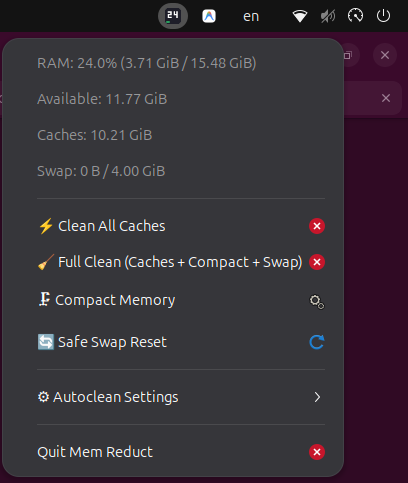

# Mem Reduct (Версия для Linux)

<p align="center">
  <a href="README.md">🇬🇧 Read in English</a> | <b>🇷🇺 Читать на русском</b>
</p>

<p align="center">
  <a href="https://github.com/anntr1k3/memreduct-linux/releases"></a>
  
  
  
</p>

Высокопроизводительный легковесный системный монитор и инструмент очистки оперативной памяти для Linux, написанный на **100% чистом Rust** по мотивам классической утилиты [henrypp/memreduct](https://github.com/henrypp/memreduct).

<p align="center">
  
</p>

Специально спроектирован для современных графических окружений Linux (GNOME, Wayland, X11, KDE Plasma) с безопасной **клиент-серверной архитектурой** и встроенным переключением между **русским и английским языками**.

---

## 🚀 Ключевые возможности

* **Мониторинг памяти в реальном времени**:
  * Честный расчёт **занятой и доступной памяти** на основе актуальных эвристик ядра Linux (`MemAvailable` из `/proc/meminfo`).
  * Детальная раскладка: **Page Cache** (файловый кэш), **Buffers**, **Reclaimable Slab** (метаданные dentries & inodes), **Dirty Pages** (грязные страницы).
  * Метрики **Swap** и **ZRAM** (коэффициент сжатия, исходный vs сжатый размер, сэкономленная память).
  * Мониторинг **PSI (Pressure Stall Information)** из `/proc/pressure/memory` для отслеживания пробуксовки памяти (*thrashing*) до срабатывания OOM Killer.
* **Безопасная и эффективная очистка**:
  * Сброс файлового кэша и метаданных с обязательным предварительным сбросом грязных страниц через системный вызов ядра `libc::sync()`.
  * **Дефрагментация памяти** (`echo 1 > /proc/sys/vm/compact_memory`) для объединения страниц HugePages.
  * **Безопасный сброс Swap** (`swapoff -a && swapon -a`) с защитой от OOM: своп сбрасывается только при наличии достаточного запаса в RAM (`Available > SwapUsed * 1.2`).
* **Клиент-серверная безопасность**:
  * Графический трей и CLI запускаются от **обычного пользователя** без прав root.
  * Привилегированные операции ядра выполняет фоновый демон (`memreduct-daemon`) через локальный Unix-сокет или точечно через Polkit (`pkexec`).
* **Индикатор в системном трее**:
  * Работает в **Ubuntu GNOME (Wayland)** и KDE Plasma через спецификацию StatusNotifierItem (AppIndicator).
  * Динамический бейдж с отображением процента памяти (например, `24%`) и цветной полосой нагрузки (зелёный < 60%, жёлтый 60–85%, красный > 85%).
  * Меню по правому клику: статистика, ручная очистка, дефрагментация, сброс swap, таймеры и **выбор языка (Русский / English)**.
* **Автоматизация и уведомления**:
  * Автоматический сброс кэшей при заполнении RAM выше заданного порога (например, > 80%).
  * Автоматический сброс памяти каждые N минут (по таймеру).
  * Нативные всплывающие уведомления рабочего стола с отчётом об освобождённой памяти.
* **Глобальный хоткей (бинд клавиш)**:
  * Возможность мгновенной очистки памяти нажатием комбинации клавиш (например, `Ctrl+F1` или `Ctrl+Alt+M`) из любой полноэкранной игры или программы.
* **Информативный консольный CLI**:
  * Красивый цветной вывод статуса (`memreduct status`).
  * Интерактивный живой монитор (`memreduct watch`).
  * Поддержка вывода в JSON (`--json`) для скриптов.
  * Флаг принудительной локализации (`--lang ru` / `--lang en`).

---

## 🧹 Действия очистки памяти

| Действие | Механизм ядра | Описание |
|---|---|---|
| **Очистить все кэши** | `libc::sync()` + `echo 3 > /proc/sys/vm/drop_caches` | Сбрасывает дисковый кэш (PageCache), кэш каталогов (dentries) и inode. |
| **Дефрагментация памяти** | `echo 1 > /proc/sys/vm/compact_memory` | Устраняет фрагментацию физической памяти для непрерывных страниц HugePages. |
| **Безопасный сброс Swap** | `swapoff -a && swapon -a` | Переносит данные из свопа обратно в RAM. Безопасно отменяется, если свободного места $< 120\%$. |
| **Полная очистка** | Все действия в безопасной цепочке | Комплексная оптимизация: сброс кэшей ядра, дефрагментация RAM и перезапуск Swap. |

---

## 📦 Установка

Выберите наиболее удобный вариант для вашей системы:

### Вариант 1: Ubuntu / Debian / Linux Mint / Pop!_OS (.deb пакет) — *Рекомендуется*

Готовый установочный пакет (не требует компиляции и наличия Rust):

```bash
wget https://github.com/anntr1k3/memreduct-linux/releases/download/v1.0.0/memreduct_1.0.0_amd64.deb
sudo apt install ./memreduct_1.0.0_amd64.deb
```

*Пакет автоматически установит бинарники, ярлык в меню приложений, фоновую службу systemd, правила Polkit и настроит автозапуск трея.*

### Вариант 2: Любой другой дистрибутив Linux (Arch, Fedora, openSUSE и др.)

Готовый автономный архив со встроенным автоматическим установщиком:

```bash
wget https://github.com/anntr1k3/memreduct-linux/releases/download/v1.0.0/memreduct-v1.0.0-linux-x86_64.tar.gz
tar -xzf memreduct-v1.0.0-linux-x86_64.tar.gz
cd memreduct-v1.0.0-linux-x86_64
sudo ./install.sh
```

### Вариант 3: Сборка из исходников через Cargo

```bash
git clone https://github.com/anntr1k3/memreduct-linux.git
cd memreduct-linux
./scripts/install.sh
```

> [!NOTE]
> **Совместимость с графическими окружениями**:
> * **Ubuntu GNOME / KDE Plasma / XFCE / Cinnamon / MATE**: Работает из коробки без дополнительных настроек.
> * **Arch / Fedora («чистый» GNOME)**: Убедитесь, что включено стандартное расширение [AppIndicator and KStatusNotifierItem Support](https://extensions.gnome.org/extension/615/appindicator-support/).

---

## 🖥 Использование

### Запуск индикатора в трее
После установки Mem Reduct настроен на автоматический запуск при входе в систему. Чтобы запустить его прямо сейчас, найдите **Mem Reduct** в меню приложений (клавиша **Super** / **Windows**) или выполните в терминале:

```bash
memreduct-tray &
```

### Выбор языка
Правый клик по иконке в трее $\rightarrow$ **`⚙ Настройки`** $\rightarrow$ **`🌐 Язык интерфейса`** $\rightarrow$ выберите **`Русский`**, **`English`** или **`Авто (как в системе)`**.
Ваш выбор сохраняется в файле `~/.config/memreduct/tray_config.json`.

---

## ⌨️ Настройка горячей клавиши (хоткея в GNOME / Wayland)

Чтобы мгновенно очищать память по нажатию комбинации клавиш (например, `Ctrl+F1` или `Ctrl+Alt+M`):

1. Откройте **Параметры (Settings)** $\rightarrow$ **Комбинации клавиш (Keyboard)** $\rightarrow$ **Просмотр и настройка комбинаций (View and Customize Shortcuts)**.
2. В самом низу выберите **«Дополнительные комбинации» (Custom Shortcuts)** и нажмите **«+»**.
3. Заполните поля:
   * **Название:** `Mem Reduct Clean`
   * **Команда:** `memreduct clean --all --notify`
   * **Комбинация клавиш:** нажмите желаемый бинд (например, `Ctrl+F1`).
4. Нажмите **Добавить**.

Теперь нажатие этой комбинации мгновенно оптимизирует память и покажет уведомление с количеством освобождённых мегабайт!

---

## 💻 Использование через терминал (CLI)

### Просмотр текущего состояния памяти
```bash
memreduct status
```
```text
Mem Reduct (Linux Версия)
=========================================

Физическая память (ОЗУ):
 [=========                     ] 25.8%
 Занято:         4.00 GiB  |  Доступно:   11.48 GiB
 Свободно:      10.46 GiB  |  Всего:      15.48 GiB

Кэши и буферы:
 Кэш файлов:     2.22 GiB  |  Буферы:      24.9 MiB
 Очищаемый:      1.32 GiB  |  Грязные:      5.3 MiB
 Кэш ядра:      366.7 MiB  |  Очищ. Slab: 114.0 MiB

Раздел подкачки (Swap):
 Swap не настроен или отключен.

Давление на память ядра (PSI):
 Задержка (Some): 10s=0.00%, 60s=0.00%, 300s=0.00%
 Простой (Full):  10s=0.00%, 60s=0.00%, 300s=0.00%
```

### Интерактивный живой монитор
```bash
memreduct watch
```

### Очистка памяти
```bash
# Очистить файловые кэши и метаданные с уведомлением
memreduct clean --caches --notify

# Полная очистка: кэши, дефрагментация памяти и безопасный сброс swap
memreduct clean --all --notify

# Только дефрагментация физической памяти (HugePages)
memreduct clean --compact

# Принудительный выбор языка вывода (ru или en)
memreduct --lang ru status
memreduct --lang en status

# Вывод результата в формате JSON для скриптов
memreduct clean --all --json
```

---

## 🗑 Удаление из системы

Если вы захотите удалить Mem Reduct:

* **Если устанавливали через `.deb` пакет:**
  ```bash
  sudo apt remove memreduct
  ```

* **Если устанавливали через архив `.tar.gz` или из исходников:**
  ```bash
  # Из распакованного архива или папки с репозиторием:
  sudo ./uninstall.sh
  ```

---

## 🔒 Архитектура и безопасность

1. **Разделение прав:** Графический интерфейс никогда не должен запускаться от `root`. Все привилегированные вызовы ядра изолированы в `memreduct-daemon`, работающем под управлением systemd с минимальным набором capabilities (`CAP_SYS_ADMIN`, `CAP_SYS_RESOURCE`).
2. **Защита от OOM:** Сброс Swap (`swapoff -a`) в условиях нехватки RAM приводит к мгновенной аварии OOM Killer. `memreduct` проверяет наличие как минимум 20% свободного запаса в памяти перед выполнением сброса подкачки.
3. **Безопасность данных:** Перед сбросом дисковых кэшей вызывается системный вызов ядра `libc::sync()`, принудительно сохраняющий все модифицированные страницы на физический накопитель.

---

## 📄 Лицензия
GPL-3.0-or-later
